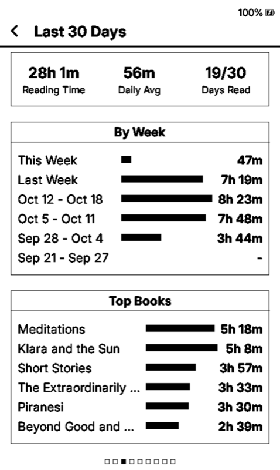
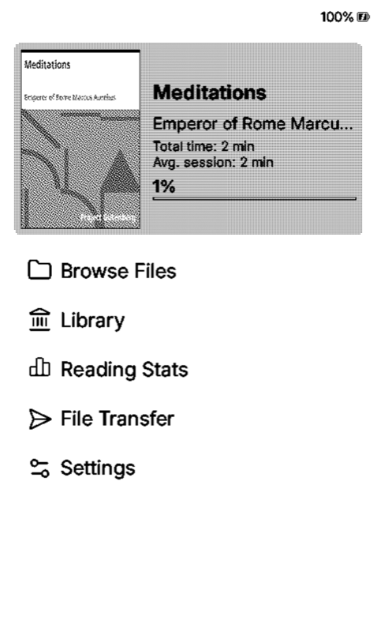
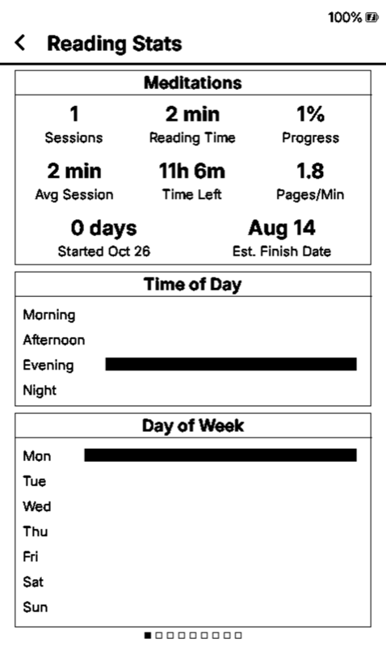

# Reading History: Last 30 Days

> This feature exists only in the [bazarcad-ai/CrossInk](https://github.com/bazarcad-ai/CrossInk) fork,
> on the `feat/reading-history` branch. It is not part of upstream
> [CrossInk](https://github.com/uxjulia/CrossInk) and is not supported there.

CrossInk's built-in stats show all-time totals and which days you read. This
feature adds the missing piece: **how many minutes you read each day, and in
which book**. Every reading session is kept permanently, and the stats screen
shows the last 30 days.

## What you get

Two kinds of pages at the end of **Reading Stats**, after the existing
*This Device* (and *All Devices*) pages:

| Last 30 Days summary | One page per week |
| --- | --- |
|  |  |

- **Last 30 Days:** total reading time, daily average, days read out of 30,
  one bar per calendar week, and your top books for the month.
- **Week pages** (Monday to Sunday): *This Week*, *Last Week*, then older weeks
  back to 30 days. Each lists the days newest first, with every book read that
  day and its minutes. Days without reading show `-`. If a busy week does not fit
  on screen, each day keeps its top books and the rest collapse into a `+N more`
  row.

## How to use it

1. From **Home**, open **Reading Stats**.

   

2. The first pages are the standard CrossInk stats. Move forward with **→**,
   the **Down** side button, or a **swipe left**. Move back with **←**, **Up**,
   or a **swipe right**. The dots at the bottom show where you are.

   

3. Past *This Device* you reach **Last 30 Days**, then the week pages.

   

While reading, you can also open stats from the in-book menu, or swipe down
for the Frontlight panel and tap the stats icon. From there, the session you
are in the middle of is already counted.

### What gets counted

The feature uses CrossInk's own reading-time rules, so its totals match the
standard stats:

- A session is saved when it ends: when you leave the book or the device goes to
  sleep. Sessions shorter than 10 seconds are ignored.
- Time on a single page longer than the **Idle Time Threshold** (Settings, 3
  minutes by default) counts as idle and is not added.
- The device needs the correct date and time. The X4 Pro has a real-time clock;
  if dates look wrong, set the time and UTC offset under
  **Settings > System > Device**.
- A session that runs past midnight is split between the two days.
- Books are grouped by title. Titles are stored up to about 47 characters.
- EPUB and XTC books are tracked. Books with stats tracking turned off are not.

## Installing

### Download a release (X4 Pro)

Prebuilt X4 Pro firmware is on the fork's
[Releases page](https://github.com/bazarcad-ai/CrossInk/releases). Each release
is named after the upstream version it is based on plus a fork build number,
for example `v1.6.1-rh.1`. Download `CrossInk-x4-pro-<version>.bin` and install
it with the SD card method below. Releases are X4 Pro only.

Releases are built by `.github/workflows/release-x4-pro.yml` whenever a tag
matching `v*-rh.*` is pushed:

```sh
git tag v1.6.1-rh.1 && git push fork v1.6.1-rh.1
```

The device's built-in online update checks official CrossInk only. When a newer
official version comes out it offers that build, which replaces this fork's
firmware (stats are kept). Install the matching fork release instead.

### Build it yourself

You need [PlatformIO](https://platformio.org/install/cli) and a USB-C data cable.

```sh
git clone --recursive -b feat/reading-history https://github.com/bazarcad-ai/CrossInk
cd CrossInk
pio run -e x4-pro                  # X4 Pro (use -e default for X3/X4)
```

**Before flashing, back up your SD card.** Copy the `/.crosspoint/` folder to
your computer (on the X4 Pro: **Home > File Transfer > USB Drive**). It holds
your settings, reading progress, and stats.

Then flash either way:

- **USB:** connect the reader and run `pio run -e x4-pro -t upload`.
- **SD card** (also works on USB-locked devices): copy
  `.pio/build/x4-pro/firmware.bin` to the SD card, then choose
  **Settings > System > SD Card Firmware Update** and pick the file.

To go back to official CrossInk at any time, install an official release the
usual way (see [Installation](./installation.md)).

## Compatibility and your existing stats

- **Standard stats are untouched.** The feature never changes the format of
  CrossInk's own files (`global_stats.bin` and each book's `stats_v5.bin`).
  Those are updated first, exactly as before; the history is written afterwards
  to its own file.
- **Its own file:** `/.crosspoint/reading_history.bin`, plus a `.bak` copy of the
  previous version kept on every save. It grows by about 8 bytes per book per
  reading day (roughly 8 KB per year of daily reading).
- **Switching back to official CrossInk** is safe. Official builds ignore
  `reading_history.bin`, and all standard stats remain. If you later reinstall
  this fork, the history picks up where it left off.
- **Do not install an older build over a newer one.** If a future CrossInk
  release changes the stats format and you then flash an older build, that
  build shows empty stats. It deliberately refuses to overwrite the newer files,
  so nothing is lost, but stats look missing until you update again. The
  history file has the same protection.
- **Reset reading stats** (Settings) also deletes the reading history.
- **Not synced or backed up:** the history stays on this device. It is not part
  of Nearby stats sync or the automatic stats backup. Copy
  `reading_history.bin` yourself if you want to keep it.
- **Tested on:** the X4 Pro firmware build and the X4 Pro simulator. The X3/X4
  build compiles in CI but has not been tested on hardware.

## Keeping up with CrossInk releases

Upstream CrossInk does not accept pull requests, so this branch is rebased
onto each new release:

```sh
git remote add upstream https://github.com/uxjulia/CrossInk   # once
git fetch --tags upstream
git rebase <new-release-tag>
pio run -e x4-pro-simulator -t run_simulator                  # test first
git push --force-with-lease
```

Most of the feature lives in new files
(`src/activities/reader/DailyReadingLog.{h,cpp}`), so conflicts are usually
limited to a few small edits in the stats screen, the session commit, and
`lib/I18n/translations/english.yaml`.

## File format

`reading_history.bin` (version 2, little-endian):

| Offset | Size | Field |
| --- | --- | --- |
| 0 | 1 | version (`2`) |
| 1 | 1 | reserved (`0`) |
| 2 | 2 | title count |
| 4 | 4 | entry count |
| 8 | 48 × titles | title records: 1-byte length + 47 bytes UTF-8; book id = record index |
| … | 8 × entries | entry records: day (u16, days since 2000-01-01), book id (u16), seconds (u32) |

There is one entry per book per local day. Saves rewrite the file through a
`.tmp` copy and keep the previous file as `.bak`; a damaged primary file falls
back to the backup.
